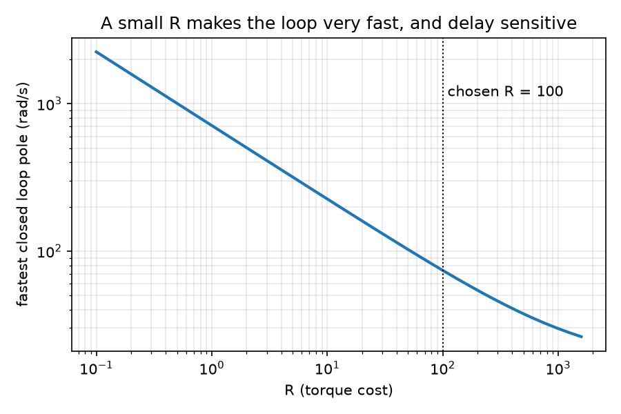
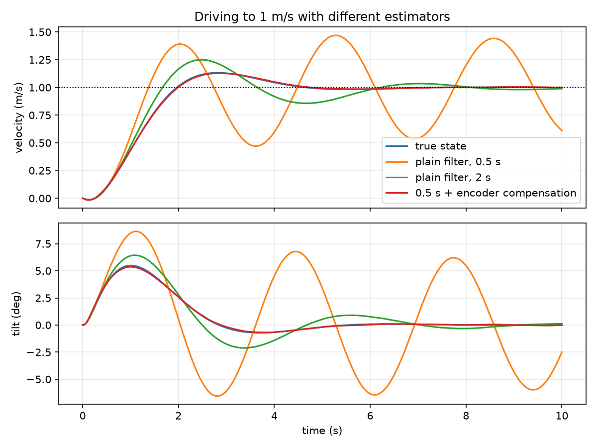
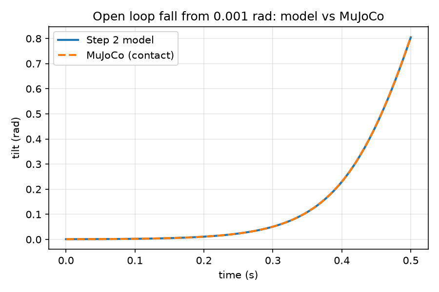
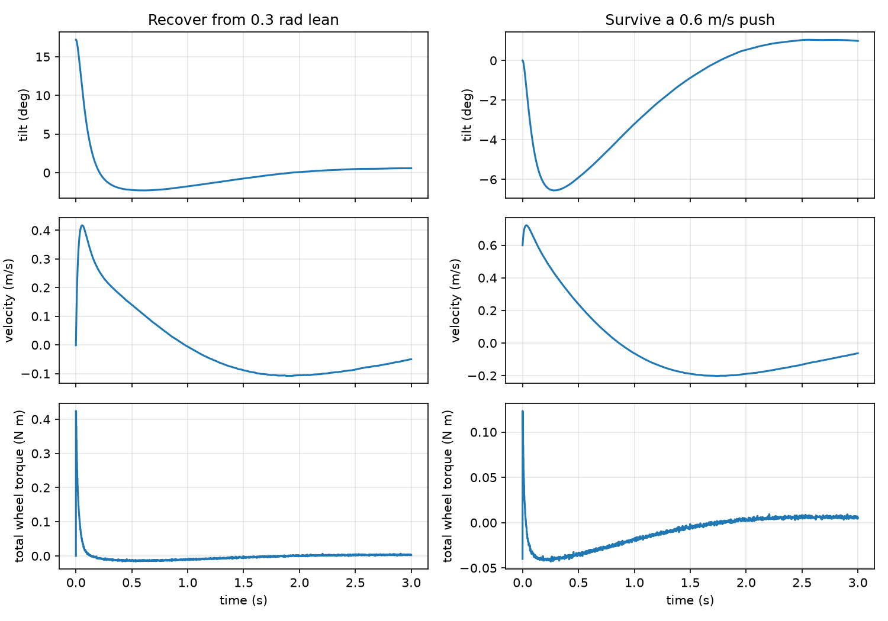

# Wheeled Balancing Robot, Phase 1: Model, Controller, and Baseline

## 1. Overview
What this document covers, in three sentences. The robot, what Phase 1 produced,
and what Phase 2 receives.
All numbers use placeholder parameters (params.yaml, git commit ____).

## 2. Conventions and parameters
x forward, tilt positive leaning forward, wheel rotation positive rolling forward.
yaw positive counterclockwise seen from above.
(parameter table with units)

## 3. Model derivation
YOUR WORKING: energies, generalized forces, Euler Lagrange equations,
linearization, state space form. Steps A to H from Step 2.
Result: A and B matrices, open loop poles of +/-15.4 rad/s.

## 4. Actuator model
Torque is the primary input. Current limit and back EMF limit. Voltage mode as secondary.
Friction as a loss at the wheel/body speed.

## 5. Yaw model
I_psi = I_z + M_eff*d^2/4. Yaw gain about 522 rad/s^2 per N m. PI on rate, P on heading.
Balance torque has priority over turning torque.

## 6. Controller
LQR, Q = diag(5,1,50,1), R = 100, K = [-0.224, -0.274, -1.420, -0.154].
Why a large R: 

## 7. Loop rate and delay
Delay margin about 12 to 20 ms. Run the balance loop at 200 Hz or faster (500 Hz target).
Latency budget target: 5 ms total.

## 8. State estimation
Complementary filter, tau 0.5 s, encoder acceleration compensation, gyro bias calibration.

## 9. Actuator demands for balance alone
Recovery from 0.3 rad: 0.43 N m total, 2.1 A per motor. Not final: Phase 2 jumps and landings decide.

## 10. Robustness
No gain scheduling needed. Risks in order: friction, forward payload offset, torque constant.

## 11. Verification
Symbolic derivation, energy conservation, linear vs nonlinear, MuJoCo cross check.

Behavior: 

## 12. Baseline for Phase 2
Table of the seven metrics from baseline_lqr.json, and the fair comparison rules.

## 13. Limitations and open items
(list from section 12.5 below)

## 14. How to reproduce
Commands in order, with expected run time.